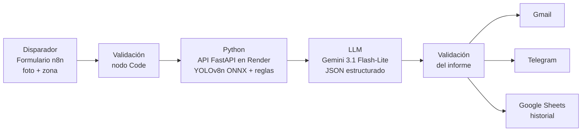

# Supervisión inteligente de EPP con IA

**Certamen 2 · IA Generativa para la Gestión Industrial · Universidad del Desarrollo**

Integrantes: Catalina Cornejo · Hellen Quiñones · Gustavo Sánchez

Sistema que automatiza la revisión del uso de Elementos de Protección Personal (EPP): un supervisor envía una fotografía y elige una zona de trabajo; el flujo detecta personas y EPP, aplica reglas de seguridad, genera un informe con IA generativa y notifica por Gmail y Telegram. **Toda alerta queda pendiente de revisión humana.**

---

## 1. Contexto industrial

| Elemento | Descripción |
|---|---|
| **Industria** | Faena minera superficial / planta industrial con tránsito de maquinaria (prototipo académico). |
| **Usuario** | Supervisor o prevencionista de riesgos. |
| **Decisión** | Qué trabajadores o zonas inspeccionar en terreno de forma prioritaria. |
| **Indicador de negocio** | _COMPLETAR (ej.: % de trabajadores con EPP confirmado, tiempo entre captura y aviso, inspecciones cubiertas por turno)_ |

**Problema:** la supervisión depende de inspecciones presenciales, que requieren tiempo y personal y no cubren todas las áreas de forma constante. Situaciones de riesgo pueden pasar inadvertidas o comunicarse tarde.

## 2. Arquitectura del flujo



| Etapa | Herramienta | Requisito del curso |
|---|---|---|
| Disparador | Formulario n8n | R6 |
| Datos | Imagen + zona de riesgo | R8 |
| Python | API FastAPI con lógica propia (asociación EPP–persona, reglas por zona) | R2 |
| Modelo | YOLOv8n preentrenado, ajustado con SH17 | R4 |
| LLM | Gemini: diagnóstico, recomendación, prioridad, justificación | R1 |
| Acción | Gmail + Telegram + registro en Sheets | R11 |

## 3. Datos

- **Dataset:** SH17 – Safe Human 17 (Hafiz Mughees Ahmad y Afshin Rahimi), Kaggle, julio 2024.
  <https://www.kaggle.com/datasets/mugheesahmad/sh17-dataset-for-ppe-detection>
- **Origen de las imágenes:** fotografías de Pexels.com en distintos entornos industriales.
- **Licencia:** CC BY-NC-SA 4.0 (uso académico no comercial, con atribución). El dataset **no se incluye** en este repositorio.
- **Contenido:** 8.099 imágenes, 17 clases, 75.994 objetos anotados.
- **Clases:** person, ear, ear-mufs, face, face-guard, face-mask, foot, tool, glasses, gloves, helmet, hands, head, medical-suit, shoes, safety-suit, safety-vest.

### Limpieza y validación

- Sin etiquetas faltantes; 0 duplicados entre `train` y `val` originales.
- 2.184 cajas excedían el borde de la imagen por 0,0000005 (error de redondeo): se ajustaron al límite en vez de eliminarlas (931 cajas ajustadas en el subconjunto).
- Clases minoritarias (≤ 400 imágenes en train): medical-suit, face-guard, safety-suit, safety-vest, ear-mufs, foot, face-mask y helmet. Se conservaron todas sus imágenes (1.255) y se completó con una selección balanceada.

| Conjunto | Imágenes |
|---|---:|
| Entrenamiento | 1.801 (−72 % respecto del original) |
| Validación | 810 |
| Prueba | 810 |

La validación original se dividió 50/50 con estratificación multietiqueta. Semilla: `2026`.

### Limitaciones de los datos

- Fotos de stock, no de una faena real: el rendimiento puede variar con otras cámaras, ángulos o iluminación.
- Clases minoritarias con pocos ejemplos en validación y prueba (por ejemplo, 11 a 15 imágenes).

## 4. Modelo y evaluación

**Elección:** YOLOv8n (Ultralytics) por ser liviano, permitir detección con cajas por trabajador y poder exportarse a ONNX para un servidor gratuito. Se usó transferencia de aprendizaje desde pesos preentrenados.

**Entrenamiento:** 640 × 640 px, lote 16, hasta 50 épocas, `patience=15`. El entrenamiento se interrumpió en la época 22 por límites de cómputo de Colab y se recuperó el mejor punto de control (`best.pt`).

**Resultados en validación (810 imágenes):**

| Precisión | Recall | mAP50 | mAP50-95 |
|---:|---:|---:|---:|
| 61,1 % | 48,0 % | 50,7 % | 31,2 % |

Mejor rendimiento por clase (mAP50): head 0,89 · person 0,87 · face 0,87. Clases críticas para el caso: helmet 0,69 · safety-vest 0,49.

### Comparación con una alternativa simple

Tarea común: ¿hay al menos un chaleco (`safety-vest`) en la imagen? Se evaluó sobre las mismas 810 imágenes de prueba.

- **Baseline:** porcentaje de píxeles amarillo/naranja/verde fluorescente (HSV). El umbral (**0,08**) se eligió solo con validación (F1 = 0,0736) y se congeló antes de evaluar en test.
- **YOLOv8n ONNX (CPU):** positivo si la clase de mayor puntaje de algún candidato es `safety-vest` con confianza ≥ 0,40.
- **Test:** 810 imágenes, de las cuales **22** contienen al menos un chaleco (2,72 %).

| Método | Accuracy | Precisión | Recall | F1 | Balanced acc. | TP | FP | FN | TN | Tiempo/imagen |
|---|---:|---:|---:|---:|---:|---:|---:|---:|---:|---:|
| Baseline HSV | 66,42 % | 3,36 % | 40,91 % | 0,0621 | 54,02 % | 9 | 259 | 13 | 529 | 0,36 s |
| **YOLOv8n ONNX** | **97,78 %** | **62,50 %** | **45,45 %** | **0,5263** | **72,35 %** | 10 | 6 | 12 | 782 | 0,60 s |

Archivos completos y matrices de confusión: `resultados/` (carpeta `Evaluacion_Baseline_Punto4` en Drive).

**Interpretación**

- YOLOv8n supera al baseline: su F1 es unas 8,5 veces mayor y reduce los falsos positivos en ~97,7 % (de 259 a 6). El baseline, al basarse solo en color, confunde otras prendas y objetos amarillos o naranjos con chalecos.
- El recall casi no mejora (40,9 % → 45,5 %): ambos métodos pierden más de la mitad de los chalecos (12 y 13 falsos negativos de 22).
- El conjunto está muy desbalanceado: clasificar todo como "sin chaleco" daría 97,28 % de accuracy sin detectar ningún caso. Por eso el criterio principal es el **F1**, no la accuracy.
- YOLO tarda ~67 % más por imagen. Los tiempos se midieron en Colab y son solo referenciales.
- Alcance: se mide presencia de chaleco por fotografía, no su localización por trabajador ni el mAP de las 17 clases. Con solo 22 positivos, las cifras tienen alta variabilidad.

**Error más costoso:** un falso negativo, es decir, que el modelo no detecte un casco o chaleco que sí está puesto, o que tranquilice al supervisor cuando falta un EPP. Con un recall de 45 % esto es una limitación real. Por eso un EPP no detectado se marca como **"no confirmado"**, nunca como infracción.

## 5. Reglas de seguridad por zona

Definidas en `api/reglas_epp_zonas.json`. Zona de ejemplo (`zona_operativa`): casco y chaleco de alta visibilidad.

Referencia normativa: DS 594 (art. 53), DS 44 (art. 7 y 13) y DS 132 (art. 32). La matriz es una **simplificación académica** y debe validarla un profesional de prevención de riesgos antes de cualquier uso real.

Parámetros de asociación: persona con confianza ≥ 0,50; EPP con confianza ≥ 0,40; el EPP se asigna a la persona que contiene al menos el 60 % de su caja.

## 6. IA generativa (Gemini)

- **Modelo:** `gemini-3.1-flash-lite`, temperatura 0,1, máximo 350 tokens.
- **Entrada:** solo los resultados estructurados (zona, EPP requeridos, detectados y no confirmados por trabajador). No recibe la fotografía ni datos personales.
- **Salida:** JSON con `diagnostico`, `recomendacion`, `prioridad` (`alta` | `media` | `baja`) y `justificacion`.
- **Restricciones del prompt:** no confundir "no confirmado" con "ausente", no declarar infracciones, no inventar leyes ni detecciones, recomendar revisión humana ante incertidumbre.

Prompt de sistema:

```text
Eres un asistente de prevención de riesgos.

Genera un informe breve en español, máximo 70 palabras en total.

Reglas:
- Usa solo los datos proporcionados.
- No confirmado NO significa EPP ausente.
- No declares infracciones ni cumplimiento definitivo.
- No inventes leyes, hechos ni detecciones.
- Las reglas de zona son ejemplos académicos.
- Recomienda revisión humana ante incertidumbre.
- La prioridad indica urgencia de revisión.
- Sé preciso, concreto y evita repeticiones.
```

Ejemplo de salida:

```json
{
  "diagnostico": "Se detectó uso parcial de EPP en zona operativa con maquinaria. Dos trabajadores presentan elementos no confirmados.",
  "recomendacion": "Realizar inspección visual inmediata en terreno para verificar el uso correcto de casco y chaleco reflectante.",
  "prioridad": "alta",
  "justificacion": "La presencia de maquinaria pesada y la falta de confirmación de elementos de protección personal críticos requieren validación humana urgente."
}
```

## 7. API de detección

Servicio FastAPI con ONNX Runtime (sin PyTorch), desplegado en Render (plan gratuito: la primera llamada tras inactividad puede tardar).

| Endpoint | Descripción |
|---|---|
| `GET /salud` | Estado del servicio. |
| `POST /analizar` | Recibe `imagen` (JPEG/PNG/WEBP, máx. 5 MB) y `zona_id`; devuelve trabajadores, EPP detectados y no confirmados. |

Autenticación con la cabecera `X-API-Key` (sin clave responde `401`).

```bash
curl -X POST "<URL_DEL_SERVICIO>/analizar" \
  -H "X-API-Key: $EPP_API_KEY" \
  -F "imagen=@foto.jpg" \
  -F "zona_id=zona_operativa"
```

## 8. Automatización en n8n

Archivo exportado sin credenciales: `n8n/flujo_epp.json`. Para importarlo: *Workflows → Import from file* y volver a crear las credenciales de Gmail, Telegram, Gemini y Google Sheets.

Manejo de errores: _COMPLETAR (ej.: rama de error ante fallo de la API, aviso si la imagen no es válida)_.

Evidencias de tres ejecuciones con datos distintos en `evidencia/` (ejecución en n8n, correo en Gmail y mensaje en Telegram).

## 9. Estructura del repositorio

```text
.
├── README.md
├── requirements.txt
├── notebooks/
│   └── certamen2_epp.ipynb
├── api/
│   ├── app.py
│   ├── best.onnx
│   ├── reglas_epp_zonas.json
│   └── Dockerfile
├── n8n/
│   └── flujo_epp.json
├── resultados/
    ├── metricas_por_clase.csv
    ├── comparacion_test.csv
    └── matriz_confusion_*.png

```

## 10. Cómo reproducir

1. Abrir `notebooks/certamen2_epp.ipynb` en Google Colab (GPU T4 para entrenar).
2. Guardar la clave de Gemini en *Secretos* de Colab con el nombre `GEMINI_API_KEY` (nunca en el código).
3. Ejecutar en orden: preparación del dataset → entrenamiento → evaluación → reglas e IA → API → comparación con el baseline.
4. Para la API local:

```bash
pip install -r api/requirements.txt
export EPP_API_KEY="<clave-propia>"
uvicorn app:app --host 0.0.0.0 --port 8000
```

Semilla fija: `2026`.

## 11. Seguridad

- No se suben claves de API, credenciales ni datos personales. Las claves se leen desde variables de entorno o secretos de Colab.
- El flujo de n8n se exporta sin credenciales.
- La IA no decide: la revisión final es del profesional de prevención.

## 12. Limitaciones

**Alcance del sistema**

- Está configurado para una zona operativa superficial de una faena minera con tránsito de maquinaria, y solo evalúa **casco y chaleco de alta visibilidad**. En otras áreas pueden requerirse guantes, botas de seguridad, mascarillas u otros elementos que quedan fuera de esta evaluación.
- Las reglas por zona son una **matriz simplificada de carácter académico**. Deben ser validadas por un profesional de prevención de riesgos antes de cualquier uso real.

**Modelo de detección**

- Rendimiento moderado en validación: mAP50 de 50,7 %. Las dos clases críticas para el caso son las más débiles: `helmet` (0,69) y `safety-vest` (0,49).
- En la prueba de chalecos (810 imágenes, solo 22 positivas), YOLOv8n superó al baseline HSV (F1 0,526 vs 0,062), pero su **recall fue de 45,5 %**: no identificó 12 de los 22 casos. Con tan pocos positivos, las cifras tienen alta variabilidad.
- Se observaron dificultades para reconocer **cascos azules y chalecos oscuros**. Probablemente se debe a que en las fotografías de entrenamiento predominan los colores más habituales de estos elementos. En esos casos, el sistema puede registrar un EPP como «no confirmado» aunque el trabajador lo esté usando.
- El entrenamiento se detuvo tras completar 22 de las 50 épocas planificadas, por el costo computacional de retomarlo. Es probable que con más épocas el modelo mejore.
- El dataset SH17 reúne fotografías de stock (Pexels), no imágenes de una faena real. El desempeño puede variar con otras cámaras, ángulos, distancias o condiciones de iluminación, y algunas clases minoritarias tienen pocos ejemplos en validación y prueba.

**Interpretación de los resultados**

- Que un EPP no sea detectado **no demuestra que falte** (oclusión, ángulo, resolución). Por eso el sistema lo informa como «no confirmado» y nunca como incumplimiento.
- La comparación con el baseline mide presencia de chaleco por fotografía, no su localización por trabajador ni el mAP de las 17 clases.

**IA generativa**

- Gemini recibe solo los resultados estructurados y puede redactar recomendaciones imprecisas. Para reducir ese riesgo se fijó una temperatura baja, un límite de salida y reglas explícitas en el prompt. Aun así, el informe es un apoyo y **la decisión final es del personal encargado**.

**Infraestructura**

- El servicio se aloja en el plan gratuito de Render, con latencia y límites de memoria: la primera solicitud tras un período de inactividad puede tardar.
- Los tiempos de procesamiento se midieron en Google Colab y son solo referenciales.

## 13. Declaración de uso de IA

Se usaron asistentes de IA, como permiten las reglas del curso. El equipo revisó el código y los textos, y cada integrante puede explicarlos.

| Herramienta | Uso |
|---|---|
| **ChatGPT (OpenAI)** | Estructura inicial del proyecto y apoyo en otras partes del trabajo. |
| **Gemini (Google)** | Apoyo en la parte del flujo de automatización y en las recomendaciones. También es el LLM del sistema (informe en JSON). |
| **Claude (Anthropic)** | Redacción inicial del README. |

Los datos de prueba provienen de un dataset público (SH17); no se usaron datos simulados.

## 14. Atribución y licencias

- Dataset SH17: CC BY-NC-SA 4.0, uso académico no comercial. Ahmad, H. M. y Rahimi, A. (2024).
- YOLOv8: Ultralytics.
- Normativa: Decreto Supremo N.º 594 (Minsal, 1999), Decreto N.º 44 (Mintrab, 2024) y Decreto Supremo N.º 132 (Minminería, 2002), disponibles en <https://www.bcn.cl>.
